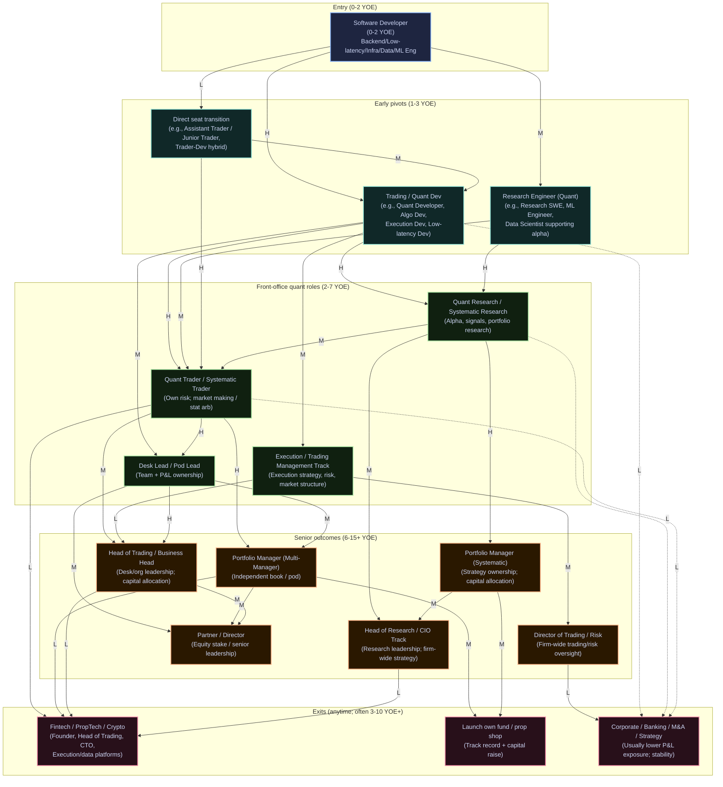

<table-of-contents>
  <li><a href="#overview">Overview</a></li>
  <li><a href="#career-progression-map">Career Progression Map</a></li>
  <li><a href="#stage-0-entry-02-yoe">Stage 0: Entry (0-2 YOE)</a></li>
  <li><a href="#stage-1-early-pivots-13-yoe">Stage 1: Early Pivots (1-3 YOE)</a></li>
  <li><a href="#stage-2-front-office-quant-roles-27-yoe">Stage 2: Front-Office Quant Roles (2-7 YOE)</a></li>
  <li><a href="#stage-3-senior-outcomes-615-yoe">Stage 3: Senior Outcomes (6-15+ YOE)</a></li>
  <li><a href="#stage-4-exits">Stage 4: Exits</a></li>
  <li><a href="#interview-preparation-by-transition">Interview Preparation by Transition</a></li>
  <li><a href="#recommended-resources">Recommended Resources</a></li>
  <li><a href="#senior-roles-in-depth">Senior Roles in Depth</a></li>
</table-of-contents>

## Overview

The path from software developer to quantitative finance is one of the most lucrative career transitions in tech. London and New York serve as the primary hubs, with firms like Citadel, Jane Street, Two Sigma, Jump Trading, and DE Shaw offering compensation packages that dwarf typical tech salaries.

This guide maps out the realistic career paths, what each transition requires, and exactly what you need to study for each jump. The chart below shows the full landscape; the sections that follow break down every transition in detail.

## Career Progression Map

---

## Stage 0: Entry (0-2 YOE)

### Software Developer

This is where most people start. You're a backend, infrastructure, data, or ML engineer at a tech company or bank. The key is building the right foundation while you're here.

**What firms look for when hiring from this pool:**

- Strong CS fundamentals (data structures, algorithms, systems design)
- Low-latency or high-performance computing experience is a major plus
- Python and/or C++ proficiency
- Any exposure to financial data, time series, or statistics
- Maths background (ideally a quantitative degree: maths, physics, CS, engineering)

**What to build while here:**

- Contribute to or build low-latency systems, data pipelines, or ML infrastructure
- Learn financial markets on your own time (market microstructure, derivatives pricing basics)
- Build personal projects with financial data (backtesting frameworks, signal research)
- Network with quant devs at meetups and through recruiters (GQR, Selby Jennings, Algo Capital)

---

## Stage 1: Early Pivots (1-3 YOE)

### A → B: Software Developer to Trading / Quant Dev

**Frequency:** High. This is the most common entry point.

A quant dev sits between pure software engineering and the trading desk. You build and maintain the systems that traders and researchers use: execution engines, pricing models, risk systems, market data infrastructure.

**What changes from your current role:**

- You'll work directly with traders and need to understand what they need
- Latency matters - microseconds can mean millions
- You'll need to understand financial instruments, not just code
- The pace is faster and the stakes are higher; bugs cost real money

**Skills required:**

| Area        | Specifics                                                                                                       |
| ----------- | --------------------------------------------------------------------------------------------------------------- |
| Programming | C++ (low-latency), Python (research/scripting), sometimes Java/Rust                                             |
| Systems     | Lock-free data structures, memory management, kernel bypass (DPDK/Solarflare), CPU cache optimization           |
| Finance     | Order book mechanics, FIX protocol, market microstructure basics, instrument types (equities, futures, options) |
| Maths       | Linear algebra, probability, basic stochastic processes                                                         |

**Interview focus:**

- Hard coding interviews (LeetCode medium/hard, system design)
- C++ deep dives: move semantics, template metaprogramming, memory models, smart pointers, virtual dispatch costs
- Low-latency design questions: "Design an order book", "How would you minimize tick-to-trade latency?"
- Brain teasers and probability puzzles (especially at prop shops)

---

### A → C: Software Developer to Research Engineer (Quant)

**Frequency:** Medium. Growing fast with the ML wave.

Research engineers support quant researchers by building the infrastructure for alpha research: data pipelines, feature engineering platforms, backtesting frameworks, and ML model training infrastructure.

**What changes from your current role:**

- Your "users" are PhDs researching trading signals
- You need strong statistical and ML intuition, not just engineering skills
- You'll work with massive time-series datasets
- The feedback loop is longer: research cycles take weeks or months

**Skills required:**

| Area        | Specifics                                                                                                                              |
| ----------- | -------------------------------------------------------------------------------------------------------------------------------------- |
| Programming | Python (NumPy, Pandas, scikit-learn, PyTorch/JAX), SQL, sometimes C++                                                                  |
| ML/Stats    | Regression, classification, time series models (ARIMA, GARCH), cross-validation for financial data (walk-forward), feature engineering |
| Data        | Large-scale data processing (Spark, Dask), data pipeline design, handling messy financial data                                         |
| Finance     | Alpha signals, factor models, basic portfolio theory, transaction cost modeling                                                        |

**Interview focus:**

- Coding (Python-heavy, data manipulation tasks)
- ML fundamentals: bias-variance tradeoff, overfitting in financial contexts, feature importance
- Statistics: hypothesis testing, multiple comparisons problem, stationarity
- System design for data/ML platforms
- "How would you build a backtesting framework?" is a classic question

---

### A → D: Direct Seat Transition (Assistant/Junior Trader)

**Frequency:** Low but growing. More common at smaller prop shops.

Some firms (Optiver, IMC, Flow Traders, smaller prop shops) hire developers directly into trading seats, especially if you have strong mental math, competitive programming background, or demonstrated market interest.

**What changes from your current role:**

- Everything. You're now making risk decisions, not writing code
- Real-time decision making under pressure
- Your P&L is tracked daily
- The learning curve is extremely steep

**Skills required:**

| Area        | Specifics                                                                           |
| ----------- | ----------------------------------------------------------------------------------- |
| Mental math | Fast mental arithmetic, estimation, expected value calculations                     |
| Probability | Game theory, optimal stopping, Bayesian reasoning, betting/Kelly criterion          |
| Markets     | Options pricing (Black-Scholes intuition), Greeks, volatility, market making theory |
| Psychology  | Emotional control, risk management discipline, decision-making under uncertainty    |

**Interview focus:**

- Mental math speed tests (Optiver's famous 80-in-8 test)
- Probability puzzles and brainteasers (coin flips, dice games, card problems)
- Market making simulations (you quote bid/ask spreads on made-up products)
- Poker/game theory scenarios
- Fit interviews focused on risk appetite and competitive drive

---

## Stage 2: Front-Office Quant Roles (2-7 YOE)

### B → F / D → F: Quant Dev / Junior Trader to Quant Trader

**Frequency:** High. The natural promotion path.

A quant trader owns risk. You're responsible for a strategy or a book, making trading decisions (often systematic) and managing positions. This is where compensation starts scaling dramatically.

**What the jump requires:**

- Demonstrated ability to think about P&L, not just code or models
- Understanding of risk management and position sizing
- Ability to generate and evaluate trade ideas independently
- Track record of contributing to strategy development or improvement

**Skills required:**

| Area      | Specifics                                                                     |
| --------- | ----------------------------------------------------------------------------- |
| Strategy  | Statistical arbitrage, market making, momentum/mean-reversion, pairs trading  |
| Risk      | VaR, drawdown management, correlation risk, tail risk, Greeks management      |
| Execution | Optimal execution (TWAP, VWAP, IS), market impact modeling, slippage analysis |
| Portfolio | Portfolio construction, factor exposure, Sharpe ratio optimization            |

**Interview focus:**

- Strategy discussions: "Walk me through a strategy you'd trade" or "How would you build a stat arb strategy?"
- Risk scenarios: "Your position is down 3% in an hour, what do you do?"
- Market structure deep dives
- Backtest analysis: "Here's a backtest, what's wrong with it?" (overfitting, survivorship bias, look-ahead bias)
- Often a take-home project: build and present a simple trading strategy

---

### B → E / C → E: Quant Dev / Research Engineer to Quant Researcher

**Frequency:** High from Research Engineer, High from Quant Dev.

Quant researchers find alpha. You develop the signals, models, and strategies that generate returns. This is the intellectual core of a systematic fund.

**What the jump requires:**

- Strong publication-quality research skills (hypothesis → test → validate)
- Deep understanding of statistical pitfalls in finance (multiple testing, non-stationarity, regime changes)
- Evidence of original alpha research or signal development
- Typically a graduate degree helps (MSc/PhD in maths, stats, physics, CS, or ML)

**Skills required:**

| Area       | Specifics                                                                                                        |
| ---------- | ---------------------------------------------------------------------------------------------------------------- |
| Statistics | Time series analysis, cointegration, PCA/factor analysis, Bayesian methods, causal inference                     |
| ML         | Gradient boosting, neural nets for time series, NLP for alternative data, reinforcement learning                 |
| Finance    | Factor models (Fama-French, Barra), portfolio optimization (mean-variance, risk parity), transaction cost models |
| Research   | Experiment design, walk-forward validation, out-of-sample testing, research documentation                        |

**Interview focus:**

- Research presentations: present a piece of original research
- Statistical questions: "How do you test if a signal is real vs. overfit?"
- Alpha generation: "Given this dataset, how would you find a tradable signal?"
- Paper discussions: "Read this paper and critique it"
- Coding tests focused on data analysis (Pandas, vectorized operations)

---

### B → G: Quant Dev to Execution / Trading Management

**Frequency:** Medium.

Execution specialists optimize how trades are placed. You reduce market impact, improve fill rates, and build execution algorithms. This is increasingly important as alpha gets harder to find.

**What the jump requires:**

- Deep understanding of market microstructure
- Experience building or optimizing execution systems
- Ability to measure and attribute execution quality

**Skills required:**

| Area            | Specifics                                                                                       |
| --------------- | ----------------------------------------------------------------------------------------------- |
| Microstructure  | Order types, venue selection, dark pools, maker/taker dynamics, queue position modeling         |
| Execution algos | TWAP, VWAP, implementation shortfall, adaptive algorithms, reinforcement learning for execution |
| Analysis        | Transaction cost analysis (TCA), market impact models (Almgren-Chriss), slippage attribution    |

---

### F → H / B → H: Trader/Dev to Desk Lead / Pod Lead

**Frequency:** High from Trader, Medium from Dev.

You take ownership of a team and its P&L. This is the first step into management while maintaining direct involvement in trading.

**What the jump requires:**

- Consistent positive P&L track record
- Ability to mentor and develop junior traders/researchers
- Strategic thinking about capital allocation and team composition
- Strong risk management across multiple strategies

---

## Stage 3: Senior Outcomes (6-15+ YOE)

### F → I / H → I: Trader/Lead to Portfolio Manager (Multi-Manager)

**Frequency:** High. This is the prize for many traders.

At a multi-manager platform (Citadel, Millennium, Balyasny, Point72), you run an independent book or pod with allocated capital. You're essentially running your own fund within a fund.

**What the jump requires:**

- 3-5+ year audited track record with strong risk-adjusted returns
- Sharpe ratio typically > 1.5 for the strategy
- Demonstrated ability to manage drawdowns
- Capital efficiency and scaling ability
- Typically need to pass rigorous due diligence on your historical P&L

**Typical compensation:** $1-10M+ (base + performance allocation, typically 10-20% of P&L)

---

### E → J: Quant Researcher to Portfolio Manager (Systematic)

**Frequency:** High.

At a systematic fund (Two Sigma, DE Shaw, AQR, Man AHL), you own a strategy or strategy suite. Less about individual discretionary decisions, more about building robust systematic processes.

**What the jump requires:**

- Track record of alpha-generating research that has been deployed
- Ability to manage a portfolio of signals/strategies
- Understanding of capacity constraints and capital allocation
- Typically 5-8+ years of research experience

---

### H → K / F → K: Lead/Trader to Head of Trading

**Frequency:** High from Lead, Medium from Trader.

You oversee the trading desk or business unit. Responsible for capital allocation across teams, hiring, and firm-level risk.

### E → L / J → L: Researcher/PM to Head of Research / CIO Track

**Frequency:** Medium.

You set the research agenda for the firm. This is the intellectual leadership path, focused on building research teams and infrastructure rather than individual alpha.

### H → N / I → N / K → N: Senior to Partner / Director

**Frequency:** Medium. The ultimate destination.

Equity stake in the firm. At the largest funds, this can be worth tens or hundreds of millions. Requires consistent multi-year track record and leadership.

---

## Stage 4: Exits

### Fintech / Crypto / PropTech

**Who does this:** Mid-career traders and developers (3-10 YOE) who want more autonomy or equity upside. Common roles include Head of Trading at a crypto firm, CTO of a trading platform, or founder of a fintech startup.

### Launch Own Fund

**Who does this:** Senior PMs with a strong auditable track record. Requires $50-200M+ in seed capital (from allocators, family offices, or personal wealth) and a compelling pitch.

### Corporate / Banking

**Who does this:** Those who want work-life balance or are tired of P&L pressure. Compensation drops significantly but hours and stress do too.

---

## Interview Preparation by Transition

### Coding & Systems (All transitions involving dev roles)

| Resource                                            | What it covers                                                 |
| --------------------------------------------------- | -------------------------------------------------------------- |
| _Cracking the Coding Interview_ (McDowell)          | DS&A fundamentals                                              |
| LeetCode (medium/hard)                              | Pattern practice; focus on arrays, dynamic programming, graphs |
| _Designing Data-Intensive Applications_ (Kleppmann) | System design foundations                                      |
| _C++ Concurrency in Action_ (Williams)              | Multithreading for low-latency                                 |
| _Effective Modern C++_ (Meyers)                     | C++ best practices for quant dev interviews                    |

### Probability & Brain Teasers (Trading roles)

| Resource                                                      | What it covers                                        |
| ------------------------------------------------------------- | ----------------------------------------------------- |
| _A Practical Guide to Quantitative Finance Interviews_ (Zhou) | The "Green Book" - essential for all quant interviews |
| _Heard on the Street_ (Crack)                                 | Classic brainteasers and probability                  |
| _Fifty Challenging Problems in Probability_ (Mosteller)       | Deeper probability thinking                           |
| _Thinking Strategically_ (Dixit & Nalebuff)                   | Game theory intuition                                 |
| Mental math practice (Zetamac, Rankyourbrain)                 | Speed arithmetic training                             |

### Mathematics & Statistics (Research and strategy roles)

| Resource                                               | What it covers                   |
| ------------------------------------------------------ | -------------------------------- |
| _Introduction to Linear Algebra_ (Strang)              | Linear algebra foundations       |
| _All of Statistics_ (Wasserman)                        | Statistics for ML/quant research |
| _Time Series Analysis_ (Hamilton)                      | Core time series methods         |
| _Pattern Recognition and Machine Learning_ (Bishop)    | ML theory                        |
| _The Elements of Statistical Learning_ (Hastie et al.) | Statistical learning foundations |

### Finance & Markets (All quant transitions)

| Resource                                            | What it covers                                                         |
| --------------------------------------------------- | ---------------------------------------------------------------------- |
| _Options, Futures, and Other Derivatives_ (Hull)    | The "bible" of derivatives                                             |
| _Trading and Exchanges_ (Harris)                    | Market microstructure                                                  |
| _Algorithmic Trading and DMA_ (Johnson)             | Execution and market structure                                         |
| _Advances in Financial Machine Learning_ (de Prado) | ML applied to finance (backtesting, feature importance, meta-labeling) |
| _Active Portfolio Management_ (Grinold & Kahn)      | Factor models, alpha, portfolio construction                           |
| _Quantitative Trading_ (Chan)                       | Practical strategy development                                         |

### Strategy & Portfolio (PM transitions)

| Resource                                                      | What it covers                                                  |
| ------------------------------------------------------------- | --------------------------------------------------------------- |
| _Quantitative Equity Portfolio Management_ (Chincarini & Kim) | Portfolio construction                                          |
| _Expected Returns_ (Ilmanen)                                  | Risk premia across asset classes                                |
| _The Man Who Solved the Market_ (Zuckerman)                   | Renaissance Technologies history (inspiration, not instruction) |
| _Market Wizards_ (Schwager)                                   | Trader interviews and mental models                             |

---

## Recommended Resources

<callout variant="tip" title="Start Here">

**If you're a software developer looking to make the jump, prioritize in this order:**

1. **Zhou's Green Book** - covers probability, brainteasers, and basic finance questions you'll face in any quant interview
2. **LeetCode** - you still need to pass coding rounds; aim for 200+ medium/hard problems
3. **Hull's Options, Futures, and Other Derivatives** - at minimum understand chapters 1-15 (futures, options, Black-Scholes, Greeks)
4. **Harris's Trading and Exchanges** - understand how markets actually work
5. **De Prado's Advances in Financial ML** - modern approach to quantitative research; shows you think like a quant, not just a developer

</callout>

### Online Courses & Practice

- **QuantConnect / Quantopian archives** - free backtesting platforms and community alphas
- **Coursera: Financial Engineering and Risk Management (Columbia)** - solid derivatives foundation
- **MIT OCW 18.S096: Topics in Mathematics with Applications in Finance** - free lecture videos covering core quant maths
- **Jane Street puzzles** (jane-street.com/puzzles) - the kind of thinking quant firms value
- **Probability & Markets Discord communities** - peer practice for interviews

### Networking

- **Recruiters**: GQR, Selby Jennings, Algo Capital, Options Group (senior roles)
- **Events**: Quant Finance meetups (London, NYC), LSEG events, CQF seminars
- **LinkedIn**: Follow quant PMs and researchers; engage with their content
- **Open source**: Contribute to quant libraries (zipline, backtrader, QuantLib) to build credibility

<callout variant="note" title="A Note on Degrees">

A PhD is not required for most paths shown above, but it significantly helps for research roles (C, E, J, L). A strong MSc in a quantitative field (maths, stats, physics, CS, ML) is sufficient for most transitions. For trading roles (D, F), demonstrated market intuition and a strong undergraduate degree are often enough. What matters most is evidence that you can think quantitatively and generate P&L.

</callout>

---

## Senior Roles in Depth

The four senior outcomes that most quant careers converge toward look similar on paper — all are high-paying, all require deep experience — but they demand fundamentally different skills, temperaments, and daily realities. This section breaks each one down in detail.

### Quick Comparison

|                       | PM (Multi-Manager)              | PM (Systematic)                        | Head of Trading                       | Head of Research / CIO                 |
| --------------------- | ------------------------------- | -------------------------------------- | ------------------------------------- | -------------------------------------- |
| Core accountability   | P&L of your own book            | Strategy suite performance             | Desk/firm-level P&L and operations    | Research pipeline and alpha generation |
| Run a live book?      | Yes — daily, actively           | Yes — systematic, monitored not traded | No — oversee those who do             | No — research feeds into PM books      |
| People managed        | Small pod (2–8)                 | Small research team (2–8)              | Large desk (10–50+)                   | Medium-large research org (5–40+)      |
| Discretion level      | High — you decide the positions | Low — the model decides                | Very high — capital, hiring, strategy | High — research direction, priorities  |
| Daily market exposure | Intense — live risk all day     | Moderate — strategy monitoring         | Low — risk dashboards not positions   | Low — P&L of others, not own book      |
| Comp structure        | Low base, high P&L share        | Low-mid base, high P&L share           | High base, bonus on desk performance  | High base, bonus on firm performance   |
| Typical all-in comp   | $1M–$20M+                       | $800k–$10M+                            | $700k–$5M                             | $500k–$3M                              |

---

### Portfolio Manager (Multi-Manager)

**What the role actually is**

You run an independent pod inside a multi-manager platform — Citadel, Millennium, Balyasny, Point72, ExodusPoint, Schonfeld. The platform provides capital, risk infrastructure, prime brokerage, and operational support. You bring a strategy, a team, and a track record. You keep 10–25% of your P&L after a funding rate that typically runs at 6–10% of allocated capital per year. If you hit your drawdown limit — usually 10–20% of capital — you are shut down, often permanently.

This is the most intensely meritocratic structure in finance. There is no politics between you and your P&L.

**Requirements to get here**

- A verified, auditable track record of 3–5+ years with Sharpe > 1.5 and controlled drawdowns
- A clear, scalable strategy (you need to be able to put $200M–$2B+ to work)
- A team or the ability to build one quickly — platforms do not want lone wolves
- The ability to survive a rigorous due diligence process (months of P&L forensics, risk attribution, counterparty calls)
- Market-making, stat arb, or multi-strategy backgrounds dominate; discretionary macro is rare here

**Day-to-day**

The rhythm is dictated by market hours. A typical day:

- **Pre-market (6:30–8:00am):** Review overnight P&L and risk, check any positions in Asian or European markets, scan for news that affects open positions, brief the team on the day's risk budget.
- **Market hours (8:00am–4:30pm):** Active monitoring of live positions. For systematic books this means watching model behaviour vs. expectations; for semi-discretionary this means active decision-making. You're managing drawdown headroom in real time — if you're down 1.5% on a day where your stop is 3%, decisions change.
- **Post-market (4:30–6:30pm):** P&L attribution — what worked, what didn't, what was execution vs. alpha. File daily risk report to the platform's central risk team. Review the next day's positioning.
- **Evening:** Research, reading, thinking about structural changes to the strategy.

**Month-to-month**

- Weekly meetings with the platform's risk management team reviewing drawdown usage, factor exposures, and any limit breaches
- Monthly capital allocation reviews — platforms dynamically re-allocate capital toward outperforming pods; a bad few months means capital reduction before a stop-out
- Ongoing hiring and team development — the PM's edge compounds through the team around them
- Quarterly strategy reviews to assess whether signals are decaying, whether new instruments or markets should be added, and whether the strategy needs to evolve

**Success metrics**

| Metric                    | Target                                |
| ------------------------- | ------------------------------------- |
| Sharpe ratio              | > 1.5–2.0 net of costs                |
| Annual return (net)       | > 15–25% on allocated capital         |
| Maximum drawdown          | < 10–15% (hard stop usually at 15%)   |
| Capital efficiency        | Can deploy $500M+ without alpha decay |
| Correlation to other pods | Low — platforms want diversification  |

**Who thrives in this role**

You need to be wired for high-stakes real-time competition. The archetypal multi-manager PM is intensely competitive, has processed hundreds of losing days without losing discipline, can manage people effectively while simultaneously managing risk, and genuinely enjoys the daily feedback loop that markets provide. Thin-skinned people do not last. People who need certainty before acting do not last. If you have ever tilted after a losing session and deviated from your strategy, this structure will find that weakness.

The best multi-manager PMs treat the job like a casino edge business: maintain your edge, control variance, do not oversize, survive drawdowns long enough to collect the expectancy. The worst blow up chasing losses.

---

### Portfolio Manager (Systematic)

**What the role actually is**

At a systematic fund (Two Sigma, DE Shaw, AQR, Man AHL, Winton, Renaissance if you can get there), you own a strategy suite rather than a live book. You are responsible for a set of models that trade autonomously. The key difference from multi-manager: the model makes the trades, not you. Your job is to build, improve, and govern the system that generates P&L, and to allocate capital across a portfolio of signals and strategies.

You are closer to a research director than a trader, but you live or die on live performance, not publications.

**Requirements to get here**

- 5–8+ years of quant research experience with demonstrably deployed alpha
- A portfolio of live or near-live strategies with measurable performance
- Ability to manage a research team and set a research agenda
- Understanding of capacity constraints — systematic funds deal with signal decay at scale
- Typically requires graduate degree (MSc or PhD); the research bar is genuinely PhD-level

**Day-to-day**

The rhythm is driven by research cadence and system health, not market hours:

- **Morning:** Review overnight execution and strategy performance vs. expectations. Flag any anomalies — unexpected drawdowns, unusual turnover, factor exposure drift. Not because you'll manually intervene, but because anomalies reveal model problems.
- **Mid-morning:** Research meetings with the team. What signals are being developed, what tests have passed, what is being prepared for live deployment. Code and research reviews.
- **Afternoon:** Strategy-level capital allocation decisions — should this signal get more or less weight given recent performance and capacity? Are there new instruments or markets to expand into?
- **End of day:** Portfolio risk review. What are the factor exposures across strategies? Where is correlation risk building?

**Month-to-month**

- Monthly performance attribution: how much P&L came from each signal, each asset class, each factor? What is decaying?
- Quarterly research roadmap review: which research themes are being explored, what new data sources are being evaluated, what has been retired
- Capacity planning: as AUM grows, signals decay faster; need to actively expand into new instruments or strategies
- Researcher development — coaching junior researchers, reviewing their output, helping them avoid the common statistical traps (overfitting, multiple testing, look-ahead bias)
- Occasionally presenting to risk committees or investment committees on strategy health

**Success metrics**

| Metric                       | Target                                            |
| ---------------------------- | ------------------------------------------------- |
| Strategy Sharpe              | > 1.0–1.5 net; higher for specific sub-strategies |
| Research pipeline throughput | N live signals deployed per year                  |
| Alpha decay                  | Signals holding up after 12–24 months live        |
| Capacity                     | Strategy can absorb capital without degrading     |
| Team development             | Junior researchers progressing to independence    |

**Who thrives in this role**

The systematic PM archetype is intellectually rigorous to the point of being uncomfortable with uncertainty they have not mathematically characterized. They have the patience of researchers — signal development cycles are measured in months, not days — but the commercial instinct to know which research actually matters for P&L.

Where multi-manager PMs are wired for adrenaline, systematic PMs are wired for intellectual satisfaction in building something that works without them touching it. The dream is a strategy that runs cleanly at 3am with no intervention. The best systematic PMs are deeply uncomfortable when they feel the urge to override the model, because they know that urge is usually wrong.

Ego is a liability here. If your model underperforms and you do not know why, the honest response is to investigate, not to override.

---

### Head of Trading / Business Head

**What the role actually is**

You have stepped off the trading floor and onto the organizational layer. Your job is to make the desk — or the firm's trading operation — work better as a whole. You allocate capital across teams, make hiring decisions, manage the politics between desks, own the relationship with prime brokers and risk counterparties, and interface with firm leadership on strategy.

The defining shift: you no longer control your own P&L. Your P&L is the aggregate performance of everyone below you.

**Requirements to get here**

- Consistent multi-year P&L track record (you cannot lead traders you could not beat)
- Demonstrated ability to build and retain talent — your job is to make other people better
- Strong grasp of organizational dynamics — you will manage people who are individually more talented than you in their specific area
- Firm-level risk management instinct (managing a portfolio of strategies and people, not a book)
- Operational credibility — you need to understand execution, technology, compliance, and capital markets broadly

**Day-to-day**

The calendar now drives the day more than markets do:

- **Morning risk review:** Scan aggregate risk dashboards across all desks. You are not managing individual positions; you are watching for anything that looks systemically wrong — too much correlation across desks, an outlier drawdown in one pod, any single-name concentration that threatens the broader book.
- **1-on-1s and team meetings:** The bulk of the day. Desk leads bring you their problems: capital requests, personnel issues, strategy changes that need approval, new market opportunities. You are a decision-maker and a resource allocator.
- **Capital allocation decisions:** The most consequential part of the role. Which desks get more capital? Which strategies get shut down? These decisions are made slowly but their impact is enormous.
- **Firm-level meetings:** Board presentations, investor updates (at external-facing funds), regulatory discussions, technology investment committees.

**Month-to-month**

- Monthly performance reviews across all desks — P&L attribution, risk-adjusted returns, team productivity
- Hiring cycles — recruiting is a near-constant activity; one strong hire compounds for years
- Quarterly capital allocation reviews — formal process of reviewing each desk's track record and adjusting allocations
- Technology and infrastructure investment decisions — trading infrastructure is a competitive moat and you own it
- Regulatory and compliance management — at scale, this becomes a genuine operational burden

**Success metrics**

| Metric                | Target                                          |
| --------------------- | ----------------------------------------------- |
| Desk aggregate Sharpe | > 1.0–1.5 across all strategies                 |
| Capital utilization   | High utilization of allocated capital           |
| P&L per head          | Strong relative to industry benchmarks          |
| Talent retention      | Low involuntary attrition among top performers  |
| Operational incidents | Zero — blowups on your watch define your career |

**Who thrives in this role**

The transition from PM to Head of Trading is not a promotion — it is a career change. Many brilliant PMs make terrible heads of trading because they cannot resist second-guessing their traders, and traders cannot function with a boss who overrides them.

The Head of Trading archetype is someone who genuinely gets more satisfaction from watching someone else succeed than from trading themselves. They are politically sophisticated in the best sense: they understand that their traders have different incentives and communicate accordingly. They are decisive under ambiguity because capital allocation decisions must be made with incomplete information. They are comfortable being evaluated on outcomes they do not fully control.

If you resent the idea of your bonus depending on what other people do, do not pursue this role.

---

### Head of Research / CIO Track

**What the role actually is**

You set the intellectual direction of the firm's research. At a systematic fund, this is one of the most powerful roles — the research agenda determines what strategies get built, and the strategies determine the P&L. At a multi-strategy fund, the Head of Research might own the quantitative research infrastructure that all pods share. At smaller funds, this role often converges with the CIO title.

The CIO variant adds investor-facing responsibilities: you are explaining the investment thesis and strategy performance to allocators, often while simultaneously running the research organisation internally.

**Requirements to get here**

- A strong publication or deployment track record in quant research — you need credibility with researchers who are often PhD-level
- The ability to evaluate research quality rigorously without doing all the research yourself
- Experience building research teams and developing research talent
- Commercial instinct: the best research ideas are worthless if they cannot be deployed at scale with acceptable risk
- For the CIO variant: investor communication skills are mandatory — you will be in rooms with sophisticated allocators who will probe every weakness in your methodology

**Day-to-day**

The day is driven by research output and team development:

- **Research reviews:** The core of the job. Junior and mid-level researchers present their work. You ask the questions that expose the weaknesses: Is this overfit? Have you accounted for turnover costs? What happens in this regime? Is the signal robust to data cleaning choices?
- **Strategy prioritization:** Of ten active research projects, which three should get the most resources? This is a constant allocation problem.
- **Working with PMs:** Translating research output into deployable strategies. Research that cannot be deployed is academic; the Head of Research is the bridge between discovery and production.
- **Team development:** One-on-ones with researchers. Identifying who has the potential to become a PM and developing that pipeline. Identifying who is technically strong but needs commercial grounding.
- **For CIO:** Investor calls, quarterly investor letters, due diligence visits. You become the public face of the fund's intellectual thesis.

**Month-to-month**

- Monthly pipeline review: what is in each stage of development (exploratory, testing, live evaluation, deployed, deprecated)
- Quarterly research planning: where should the team be investing effort over the next quarter? New asset classes, new data sources, new methodologies?
- Talent planning: who needs to be hired, developed, or managed out?
- Strategy performance review: are live strategies performing consistent with research expectations, or is there decay that research needs to address?
- Infrastructure investment: data budgets, compute resources, research tooling — these fall under research leadership

**Success metrics**

| Metric                                 | Target                                                   |
| -------------------------------------- | -------------------------------------------------------- |
| Strategies deployed from research      | N+ per year that survive at least 12 months live         |
| Pipeline quality                       | Predictive: research hit rate on strategies that go live |
| Team development                       | Senior researcher → PM promotions                        |
| Alpha decay rate                       | New signals extending the live portfolio's performance   |
| For CIO: investor retention and growth | Stable or growing AUM; low LP redemptions                |

**Who thrives in this role**

The Head of Research / CIO archetype is rare: someone who is genuinely excellent at research themselves, but who has consciously chosen to make other people more excellent rather than doing it themselves. Most researchers want to do the research. The ones who end up in this role are those who get genuine satisfaction from watching a junior researcher produce something outstanding.

They are intellectually honest to a fault — they will kill a promising-looking strategy if the statistical evidence doesn't hold up, even when the PM wants to deploy it. They communicate complex ideas clearly, because their job requires convincing non-technical stakeholders (investors, board members) that the methodology is sound.

The failure mode is the reverse: a technically brilliant researcher who cannot stop doing research long enough to manage. The best researchers often become the worst research leaders for exactly this reason. The ones who succeed in this role have made peace with the fact that their most important output is no longer a signal, but a team.

<callout variant="tip" title="Which Role Is Right for You?">

The simplest way to self-diagnose:

- **Multi-manager PM:** Do you need daily feedback and competition to feel alive? Can you manage people while managing risk simultaneously without dropping one? Can you be shut down for underperformance and start again?
- **Systematic PM:** Do you derive more satisfaction from building a system that works autonomously than from making the trade yourself? Are you more comfortable with a 3-month research cycle than a 3-minute trading decision?
- **Head of Trading:** Are you genuinely more satisfied when your team succeeds than when you do? Do you find organizational problems interesting rather than annoying? Can you let go of your own P&L identity?
- **Head of Research / CIO:** Do you want to shape how an entire organisation thinks about markets? Can you evaluate and mentor people who are individually more technically capable than you? Can you translate research rigour into investor-facing language?

Most people who reach Stage 3 will feel a pull toward one of these archetypes well before they formally arrive there. The path is usually legible by the time you are 4–5 years in — pay attention to what energises you, not just what you are good at.

</callout>
